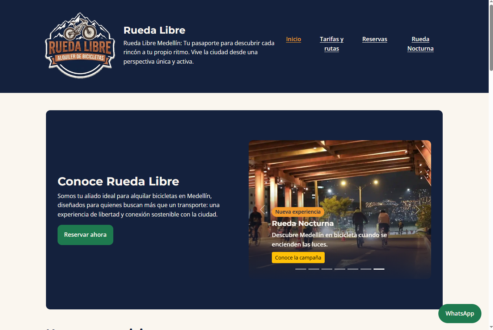
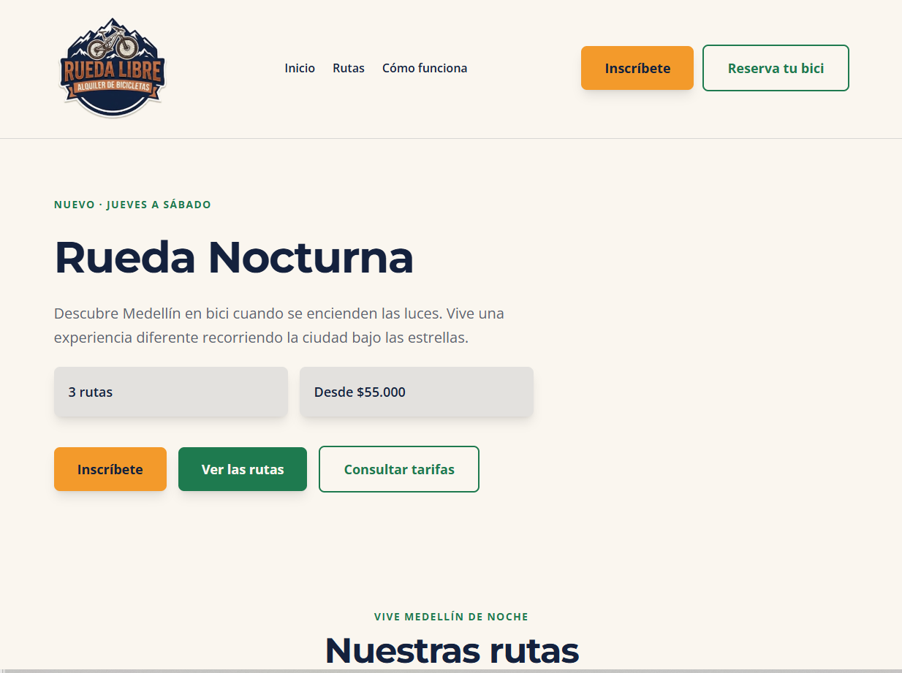
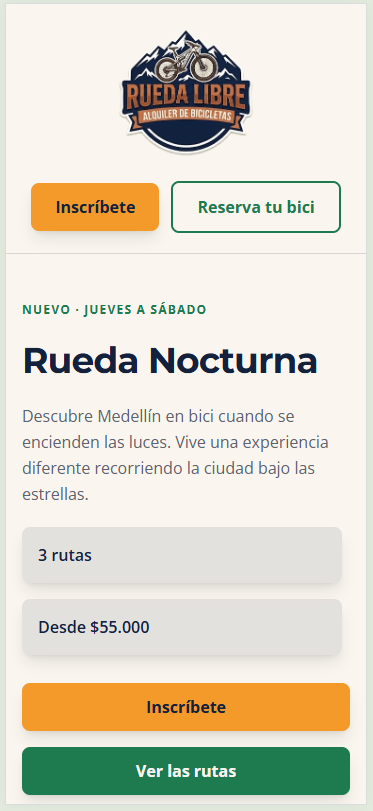
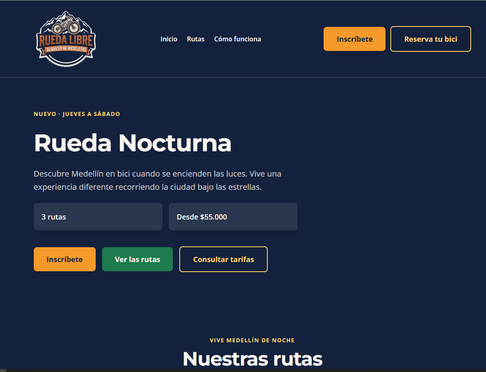

# 🚴 Rueda Libre v2.0

**Alquiler de bicicletas y experiencias urbanas en Medellín, Colombia.**

Rueda Libre es un proyecto web desarrollado como parte del proceso de formación en RIWI. Su propósito es ofrecer una experiencia digital para conocer los servicios de alquiler de bicicletas, consultar tarifas y recorridos, y descubrir experiencias nocturnas por Medellín.

El proyecto integra un sitio web desarrollado con **Bootstrap 5** y una landing page complementaria construida con **Tailwind CSS 4**.

## 🌐 Proyecto publicado

- **Sitio principal:** https://selenwing-wq.github.io/rueda_libre_v2/
- **Rueda Nocturna:** https://selenwing-wq.github.io/rueda_libre_v2/nocturna/

## 📄 Secciones del proyecto

### Sitio principal — Bootstrap

- `index.html`: página de inicio, servicios, rutas y flota de bicicletas.
- `paginas/tarifas.html`: tarifas de alquiler y recorridos.
- `paginas/reservas.html`: formulario de reserva de bicicletas.

### Landing page — Tailwind CSS

- `nocturna/index.html`: presentación de Rueda Nocturna, recorridos, planes e inscripción.

### Experiencias nocturnas

- **Luces del Centro:** 10 km, 2 horas.
- **Miradores de la Ciudad:** 16 km, 3 horas.
- **Luna en Las Palmas:** 22 km, 3,5 horas.

Los planes incluyen opciones individuales, para parejas y grupos.

## 🛠️ Tecnologías utilizadas

- HTML5.
- CSS3.
- Bootstrap 5.3.3.
- Tailwind CSS 4.3.5.
- JavaScript.
- Google Fonts: Montserrat y Open Sans.
- Git y GitHub.
- GitHub Pages.

## 🎨 Identidad visual

El proyecto utiliza una identidad visual compartida entre Bootstrap y Tailwind:

| Color | Código |
|---|---|
| Verde Ruta | `#1E7A4F` |
| Naranja Pedal | `#F39A2B` |
| Azul Noche | `#14213D` |
| Crema | `#FAF6EF` |
| Gris Asfalto | `#5B6470` |
| Amarillo Farol | `#FFD166` |

## ⚙️ Funcionalidades

- Diseño adaptable a diferentes tamaños de pantalla.
- Navegación entre las páginas principales y la landing nocturna.
- Catálogo de bicicletas y servicios.
- Carrusel de servicios y experiencias.
- Información de tarifas y recorridos.
- Formularios con validaciones HTML.
- Navegación mediante teclado.
- Indicadores visuales de enfoque.
- Modo claro y oscuro en Rueda Nocturna.
- Botón de contacto por WhatsApp.
- Estilos personalizados y componentes reutilizables.

**Nota sobre los formularios:** las validaciones funcionan en el navegador. El proyecto no cuenta actualmente con un backend ni almacena las inscripciones o reservas.

## 🧪 Pruebas y validación

Se realizaron comprobaciones de:

- Estructura semántica HTML.
- Jerarquía de encabezados.
- Atributos alternativos de imágenes.
- Asociación entre etiquetas y campos de formularios.
- Navegación con teclado.
- Existencia de rutas locales e imágenes.
- Enlaces internos.
- Diseño adaptable.
- Modo claro y oscuro en Rueda Nocturna.
- Compilación y minificación de Tailwind CSS.

Las tres páginas principales fueron verificadas con **Nu Html Checker (W3C)**:

- Página principal: cero errores y cero advertencias.
- Rueda Nocturna: cero errores y cero advertencias.
- Formulario de reservas: cero errores y cero advertencias.

## 📸 Capturas de pantalla

### Sitio principal — Bootstrap

### Rueda Nocturna — Tailwind CSS

**Vista de escritorio**

**Vista móvil**

**Modo oscuro**

## 📚 Aprendizajes

Durante el desarrollo se trabajó en:

- Estructura semántica y accesibilidad HTML.
- Selectores CSS, especificidad y modelo de caja.
- Diseño responsive con Flexbox y Grid.
- Componentes y utilidades de Bootstrap.
- Configuración y personalización de Tailwind CSS.
- Diseño de formularios y validaciones.
- Gestión de temas claros y oscuros.
- Organización de archivos y rutas.
- Control de versiones con Git y GitHub.
- Publicación de proyectos con GitHub Pages.
- Comparación de frameworks y toma de decisiones técnicas.

### Decisión técnica: Bootstrap vs. Tailwind CSS

Bootstrap fue utilizado en el sitio principal por su sistema de componentes prediseñados y su facilidad para construir interfaces completas.

Tailwind CSS fue elegido para Rueda Nocturna porque permitió construir una identidad visual más personalizada mediante clases utilitarias, variantes responsive y soporte para modo oscuro.

Ambos frameworks demostraron ser útiles dependiendo de las necesidades de cada interfaz.

## 🗂️ Documentación adicional

El archivo `bitacora.txt` conserva el registro del proceso de aprendizaje, los MiniRetos realizados, las pruebas, los cambios y los tiempos de trabajo.

## 👨‍💻 Autor

**Felipe Jaramillo González**

Proyecto desarrollado durante el proceso de formación en RIWI.

---

**Rueda Libre v2.0 — Medellín, Colombia.**